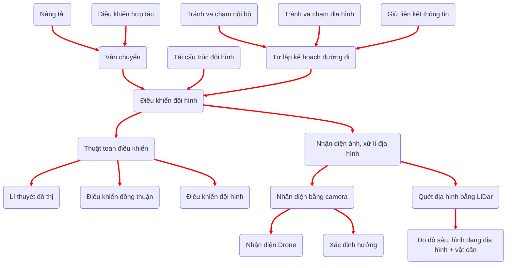

# Overview

## Yêu cầu bài toán

## Chia nhiệm vụ từng nhóm

### Nhóm thuật toán điều khiển đội hình
- Thiết kế thuật toán trên lí thuyết sử dụng các thuật toán điều khiển bền vững, dự báo, mạng noron,...
- Thiết kế trình mô phỏng, kiểm thử thuật toán

### Nhóm AI, xử lí ảnh
- Sử dụng, tùy chỉnh các mô hình nhận diện ảnh có sẵn để nhận diện Drone, con người
- Thực hiện thử nghiệm trên máy tính nhúng
- Tìm hiểu, triển các mô hình TinyML trên vi điều khiển ESP32

---

# Các công cụ thiết kế + mô phỏng
## Mô phỏng + kiểm thử thuật toán, công thức
- Matlab/Simulink
- C/C++
- Python

## Nhúng thuật toán + mô phỏng trong môi trường thực tế ảo
### NVIDIA Iaac Sim (Issac Lab / Pegasus Simulator)
- Do hoa cao
- Phu hop voi viec mo phong cam bien Camera/Lidar, vat li PhysX GPU
- Co ho tro UAV + PX4 + ROS 2
- Yeu cau VRAM > 8Gb

### MuJoCo (MuJoCo MJX)
- Do chinh xac vat li va tiep xuc/day cap hang
- Chay song song GPU -> Nhe hon Issac Sim
- Tu dong ket noi ROS2
- Co plugin ROS2 / de boc bang Python/C++
- Yeu cau khong qua cao, co the chay muot ngay ca voi 4Gb VRAM

### Genesis
- Da vat li tren GPU (vat ran, day cap/vat mem, chat long), chay cuc nhanh bang Python
- Tu dong ket noi qua ROS2, Python / UDP
- Yeu cau: GPU NVIDIA (CUDA) hoac AMD/Intel, nhe hon Issac Sim (4-6Gb VRAM)

### Chuyên dụng cho hàng không (UAV)
- Flightmare (Đồ họa đẹp, tốc độ cao)
- X-Plane / FlightGear (Mô phỏng khí động học thực tế)
- RotorTM (Mô phỏng UAV bầy đàn mang tải treo dây cáp)

## Nguyen li hoat dong
### RotorTM
- Su dung ket gop voi Rviz va Ros1 noetic
- Tao cac mo hinh drone va day cap bang file yaml
- Mo phong dong hoc + dieu khien bang cac node Ros1 bang Python

### MuJoCo
- Su dung thu vien tinh toan vat li viet bang C/C++
- MuJoCo la mot thu vien: Chuong trinh nam giu vong lap chinh, con MuJoCo chi dong vai tro nhu mot ham toan hoc. Moi chu ki thoi gian, code day lenh dieu khien vao va goi ham mj_step() de MuJoCo tinh ra trang thai vat li tiep theo.

# Huong dan su dung phan mem mo phogn
## RotorTM

## MuJoCo

