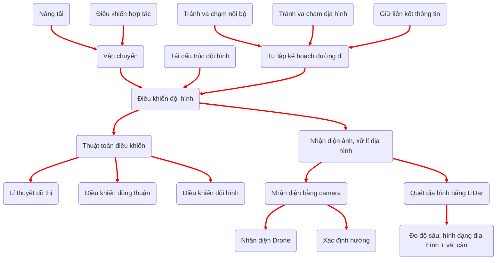

# Overview

## Yêu cầu bài toán

## Chia nhiệm vụ từng nhóm

### Nhóm thuật toán điều khiển đội hình
- Thiết kế thuật toán trên lí thuyết sử dụng các thuật toán điều khiển bền vững, dự báo, mạng noron,...
- Thiết kế trình mô phỏng, kiểm thử thuật toán

### Nhóm AI, xử lí ảnh
- Sử dụng, tùy chỉnh các mô hình nhận diện ảnh có sẵn để nhận diện Drone, con người
- Thực hiện thử nghiệm trên máy tính nhúng
- Tìm hiểu, triển các mô hình TinyML trên vi điều khiển ESP32

---

# Các công cụ thiết kế + mô phỏng
## Mô phỏng + kiểm thử thuật toán, công thức
- Matlab/Simulink
- C/C++
- Python

## Nhúng thuật toán + mô phỏng trong môi trường thực tế ảo
### NVIDIA Iaac Sim (Issac Lab / Pegasus Simulator)

### MuJoCo (MuJoCo MJX)

### Chuyên dụng cho hàng không (UAV)
- Flightmare (Đồ họa đẹp, tốc độ cao)
- X-Plane / FlightGear (Mô phỏng khí động học thực tế)
- RotorTM (Mô phỏng UAV bầy đàn mang tải treo dây cáp)
